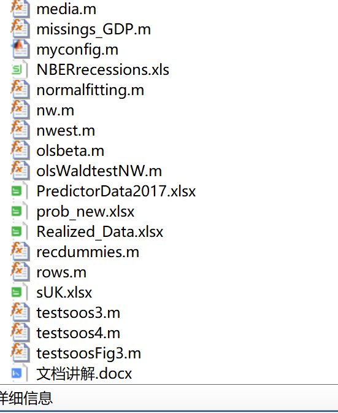
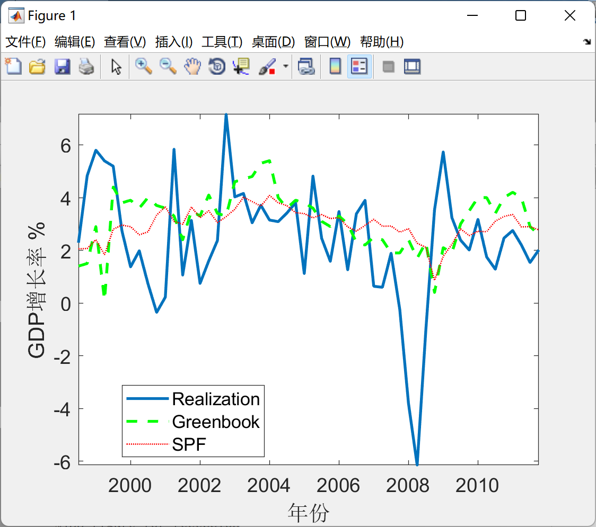
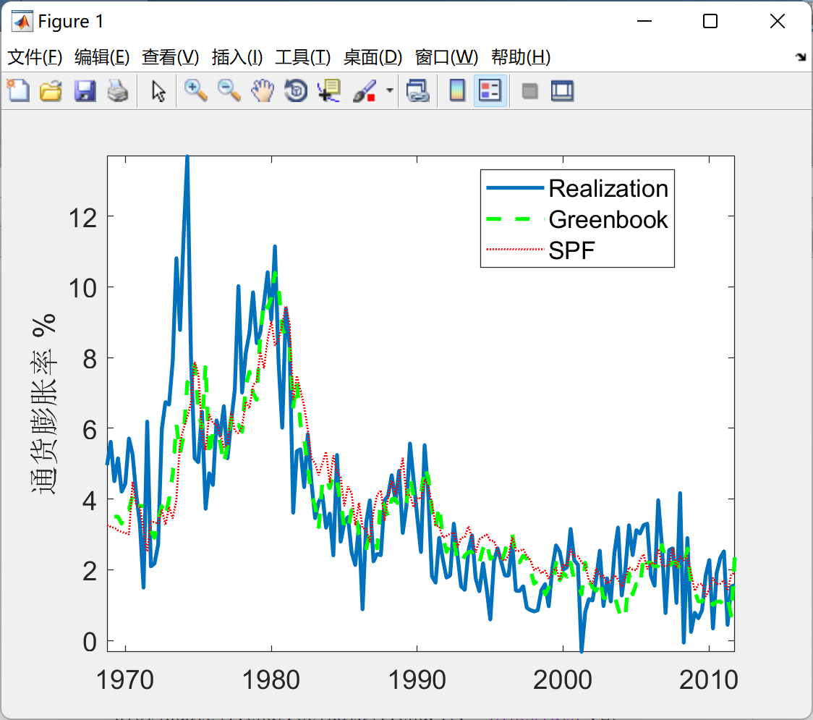
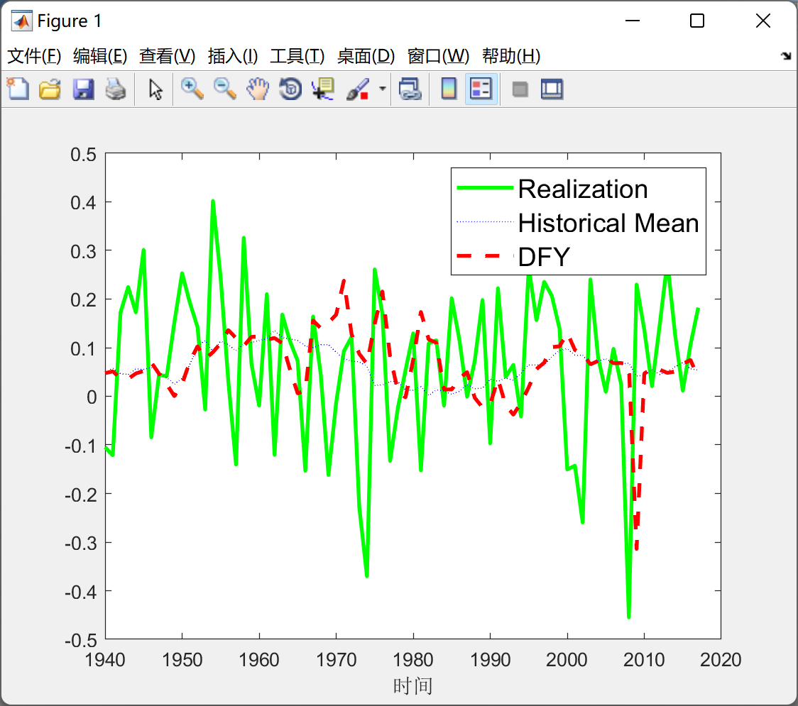
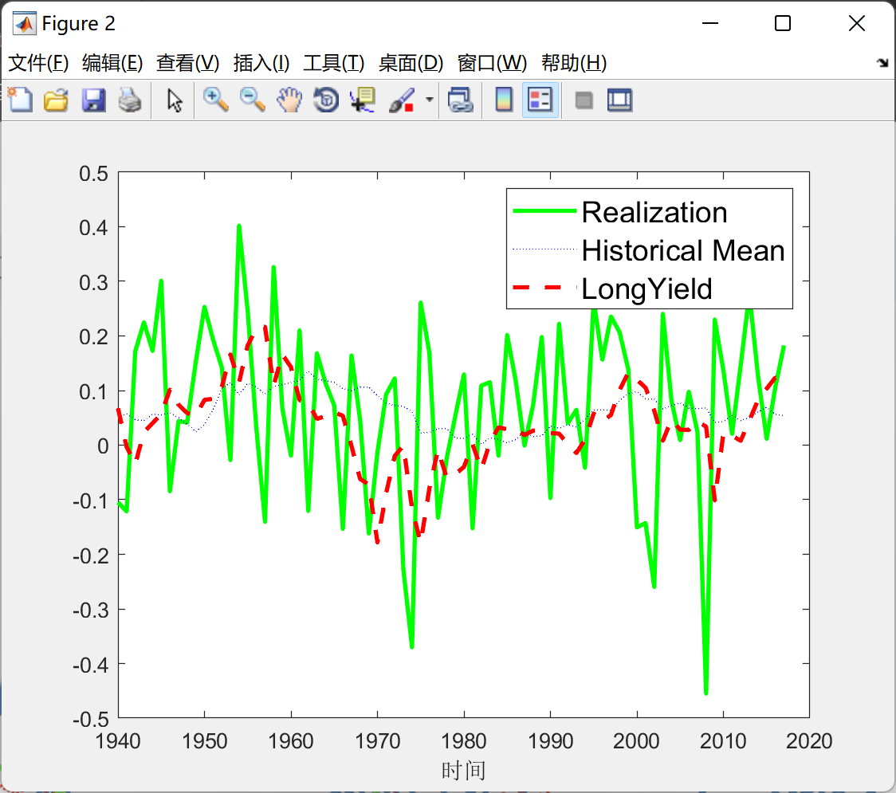
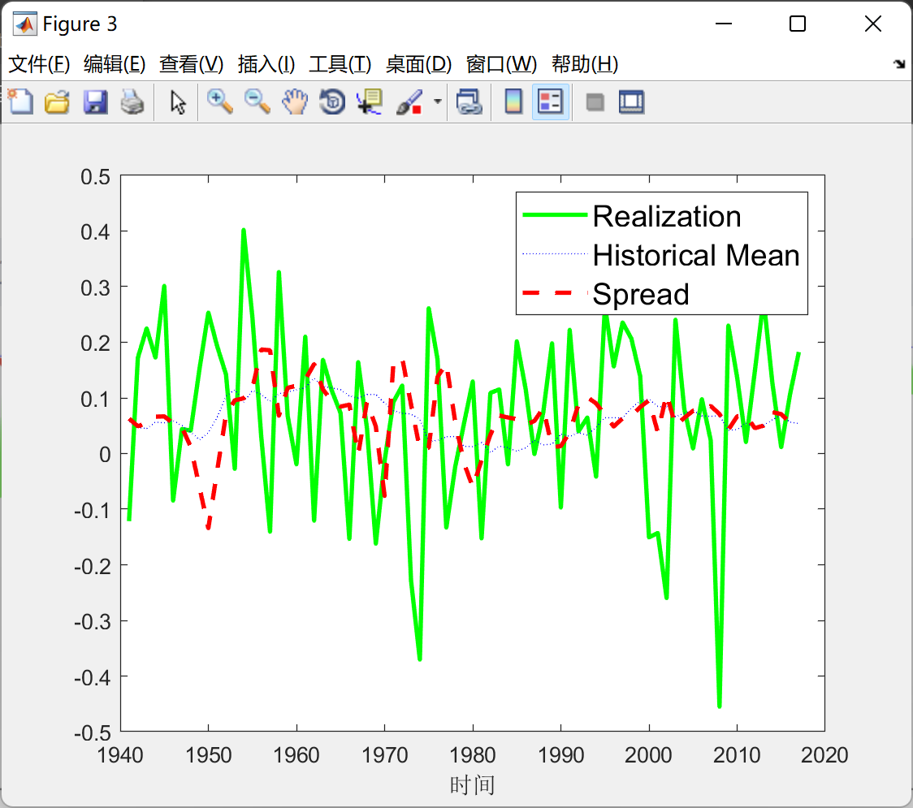
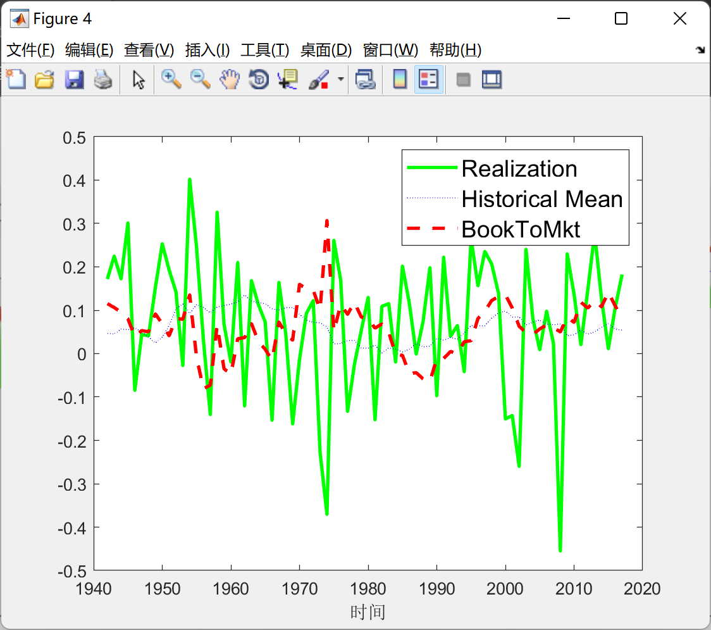
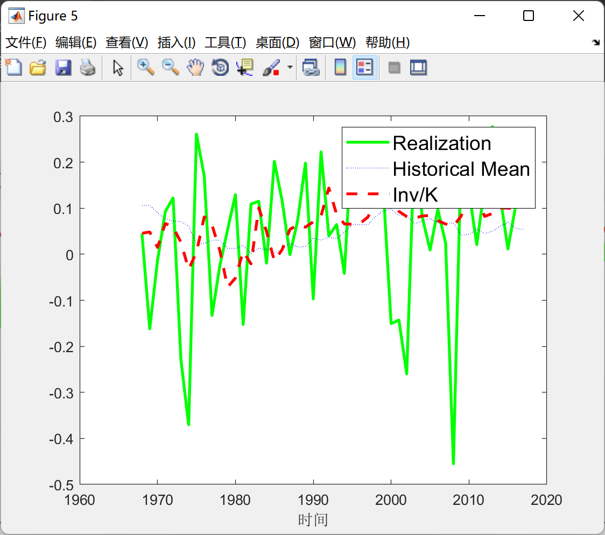
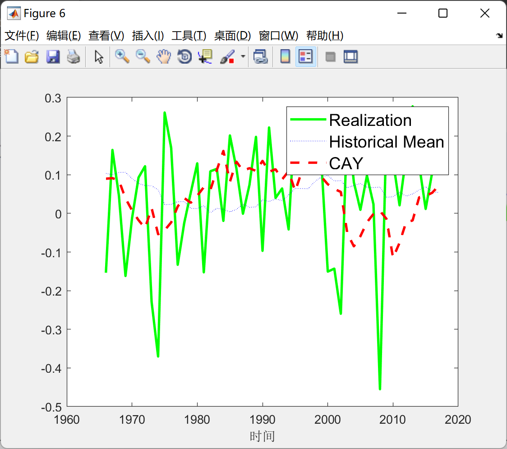

# Forecasting Economic Instability (Matlab Code + Data + Documentation)

\n        \n      clear all; close all; clc\n\n\nstrategy = 'abs';\nvariables = {'GDP', 'Inflation'};\nvarnum = 1;   \nvariable = variables{varnum};\n\n\n    % Load data\n    [A,B]  = xlsread(sprintf('../data/DataExtended_%s.xlsx', strategy), variable);\n    transf = A(1,2:end);\n    data = A(2:end,2:end);\n    date = A(2:end,1);\n    h = (0:1:(transf(:,end)));\n    T = size(data,1);\n    R = 60;\n\n\n    pdate = [1968.75:0.25:2011.75]';\n    ptruncdate = NaN(h(1,end)+1,3,T-R+1);\n    resultstoplot = NaN(h(1,end)+1,3,T-R+1);\n    critvalues = NaN(h(1,end)+1,3);\n\n\n    table = [];\n    i = 4;\n        seldata = data(:,ismember(transf,(i-1)));\n        \n        %JEL figure for recession\n            fn = figure;\n            plot(pdate(120:end),seldata(120:end,1), 'LineWidth',2)\n            hold on\n            plot(pdate(120:end),seldata(120:end,2), '--g', 'LineWidth',2)\n                hold on\n                plot(pdate(120:end),seldata(120:end,4), ':r', 'LineWidth',1)\n                legend('Realization','Greenbook','SPF','Location','best')\n            xlabel('Year');\n            ylabel('GDPGrowth rate %');\n            set(findall(gcf,'Type','axes'),'FontSize',14)\n            axis tight\n            saveas(gcf,'Figure1.png');\n            hold off\n\n% Here is part of the code\n\n\n\n  
\n        \n      \n        \n      \n        \n      \n        \n      \n        \n      \n        \n      \n        \n      \n        \n  

## Images

<!-- PAYMENT_BLOCK -->

## Get this dataset

- Payment link (Stripe): [Buy now](https://buy.stripe.com/3cs8yP7sY87d0vu9AB)
- Payment QR code: 

<!-- /PAYMENT_BLOCK -->
